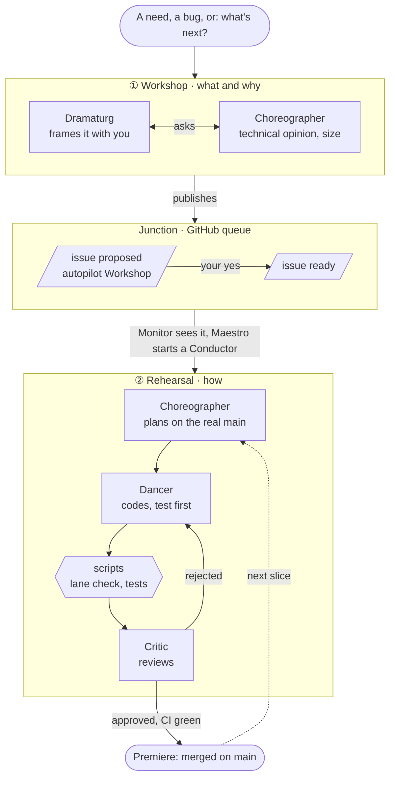
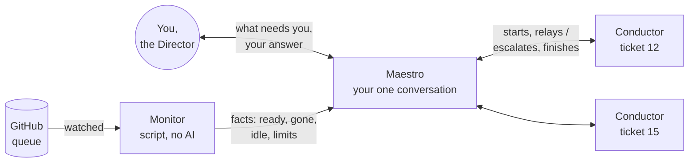

# Ballet

**A software factory made of coding agents.** You decide what to build. Agents plan it, code it, review it and merge it, one pull request at a time, and stop to ask you whenever a decision is yours.

Ballet is a plugin for Claude Code, Grok and Mistral Vibe. Install it once, and every project gets the same method.

> **Status:** under construction, used on real projects. Current version in [`plugin.json`](.claude-plugin/plugin.json); what is shipped in [`release.md`](release.md), what comes next in [`opportunities.md`](opportunities.md).

## Why

Coding agents are good at writing code. They are not good at knowing when to stop, staying in their lane, or proving that what they did works. Left alone, one agent frames, plans, codes and grades its own homework.

Ballet splits that work the way a team would, between agents that each do one thing, and puts scripts, not agents, in charge of what must be trusted: what each one may touch, whether the tests pass, when the code is merged. You stay the one who decides, and you choose how much you let go.

## The cast

The vocabulary comes from the stage. You are the **Director**.

| Who | Does |
|---|---|
| **Dramaturg** | frames a need with you: what to build and why, written as testable criteria |
| **Choreographer** | reads the code and writes the technical plan; cuts a big feature into small slices |
| **Dancer** | codes the plan, test first |
| **Critic** | reviews the pull request and gives a verdict; never writes |
| **Conductor** | runs the four roles for one ticket, carries their questions, publishes on GitHub, merges |
| **Maestro** | the one conversation you keep open: it tells you what needs you, and starts the Conductors |

A ticket played from plan to merge is a **Rehearsal**. Its merge on `main` is the **Premiere**.

## A ticket's life

Two loops, joined by the GitHub queue. The **Workshop** decides *what* to build; the **Rehearsal** decides *how*, and ships it.



1. **Frame.** You talk with the Dramaturg about a need, a bug or "what's next?". It asks the Choreographer for a technical opinion early, because a technical constraint can change the product choice. Out comes a GitHub issue, ready to be played. No plan yet.
2. **Queue.** Ballet's queue is simply GitHub: ready issues, by priority. A small script, the **Monitor**, watches it and tells Maestro; Maestro starts a Conductor, on its own for the kinds of work you allow, otherwise after asking you.
3. **Plan.** The Choreographer plans at the last moment, on the real `main`, so the plan is never stale. A big feature becomes two or three slices, each a complete Rehearsal that delivers something usable. A small ticket, with nothing left to decide, skips this step.
4. **Code.** The Dancer writes a failing test, makes it pass, commits. Ballet's scripts then check that it stayed in its lane and run the tests themselves.
5. **Review.** The Critic, a different model from the Dancer, reviews the diff while, if the project has one, a mutation test checks that the tests really catch bugs. A rejection goes back to the Dancer, twice at most.
6. **Premiere.** Approved and with a green CI, the pull request is merged. The next slice starts from the new `main`.

Every question, plan, answer and verdict is published on the issue or the pull request. GitHub holds the whole story.

## Principles

- **Simple is complex enough.** The method adds as little machinery as it can.
- **One role, one job.** A role gets a piece of work and returns a result. It does not know who runs before or after it, which model plays the others, or whether you are watching.
- **Scripts hold the trust.** A deterministic script, not a model, checks what each role touched, runs the proof, and does every GitHub operation. A role that oversteps is sent back once, then you decide. Nothing reaches `main` except through a reviewed, green pull request.
- **You choose the autonomy, not the roles.** Each loop runs `assisted` (you approve the plan and receive every escalation) or `autopilot` (each role decides within its lane, writes down what it decided alone, and flags it for you). Switching changes the plumbing, never the roles.
- **It can always ask you.** Written triggers stop the line and bring the decision to you: a question nobody else can answer, a review that does not converge, red tests that stay red, a diff too large. Waiting for you is never a failure.
- **Everything is traced.** Every step, its duration and its cost are recorded, so you can measure before you let go.

## Watching over it

You do not babysit terminals. Three pieces run across all your projects:



- **Maestro**, a session you can reach from your phone, wakes when something needs you, tells you why and what to decide, and carries your answer back.
- **The Monitor**, a script with no AI, watches GitHub, the Conductors and Claude's usage limits, and only reports facts.
- **The Stage**, a local web page, shows what plays, what waits for you, and what each ticket cost in time and money.

Ballet stands on [Orca](https://github.com/stablyai/orca), which launches the agents, supervises them and carries their messages.

## Get started

You need macOS with Orca, Claude Code (or Grok, or Mistral Vibe), an authenticated `gh`, Python 3.11+, and a CI on your project. Then:

```sh
git clone <this repo> ~/Workspace/ballet
python3 ~/Workspace/ballet/scripts/reset_plugin.py    # install the plugin, once per machine
```

```
/ballet:setup           # once per machine: registers your projects, starts Maestro and the Monitor
/ballet:init-project    # once per project, in its folder: its profile, GitHub fields, AGENTS.md
/ballet:dramaturg       # frame your first feature
/ballet:rehearsal #12   # play an issue (or let Maestro start it)
```

Details and troubleshooting: [Install, update, uninstall](docs/install.md).

## Learn more

The README is for people. The pages below are the reference, precise enough for agents to follow.

| Page | Covers |
|---|---|
| [Install, update, uninstall](docs/install.md) | requirements, what each command installs |
| [Rehearsals and Workshops](docs/rehearsal.md) | modes, plans, sizes, autopilot framing, what to answer when the Conductor stops |
| [Maestro, the Monitor and the machine](docs/maestro.md) | launching, limits, capacity, restart, where the state lives |
| [The Stage](docs/stage.md) | what each page shows |
| [Configuration](docs/configuration.md) | the project profile, mutation testing, GitHub fields, languages |
| [`PRD.md`](PRD.md) | the full method and its reasons (in French) |

## Known limits

- Attended only: your own Mac, with Orca open. Running headless on a server comes later.
- One repository per project.
- The Conductor runs roles with Claude Code, Codex, Grok or OpenCode; Mistral Vibe only by hand for now.
- Mutation reports are read for cargo-mutants (Rust) only; other tools work on their exit code.

## Developing Ballet

```sh
python3 -m unittest discover -s tests
```

Repo rules: [`AGENTS.md`](AGENTS.md).
