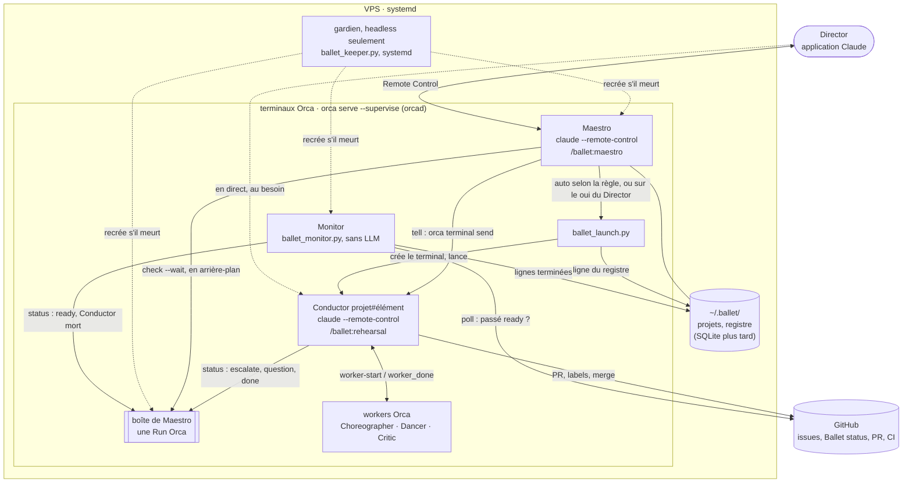
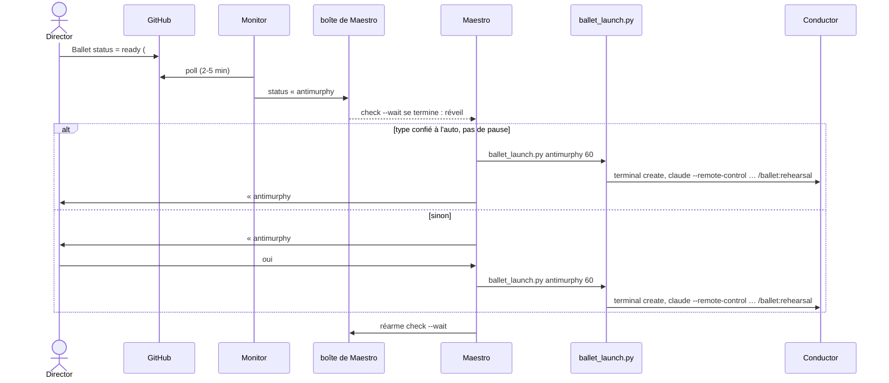
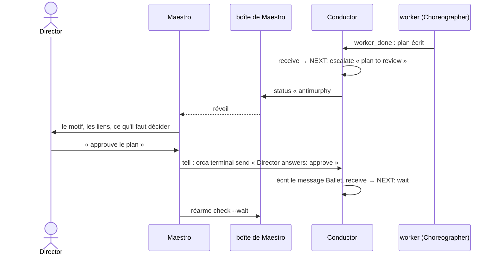

# Spike 0001 — Maestro (le superviseur) joignable par les Conductors, et Orca sans fenêtre

Date : 2026-11-20. Branche : `spike/headless-orca`.

## Question

Le Directeur veut parler à une seule session (Maestro, sur un VPS, en Remote Control) qui lance les
Conductors dans le bon projet, suit leur état, et apprend leurs escalades sans les lire terminal par terminal.
Deux inconnues :

1. Un processus qui n'est pas un terminal Orca (la session de Maestro) peut-il recevoir les messages des
   Conductors, et être réveillé par eux ?
2. Orca tourne-t-il sans fenêtre (`orca serve`) assez bien pour porter les Conductors et leurs workers ?

## Ce qui a été essayé (Orca local, macOS, application de bureau ouverte)

| Essai | Résultat |
|---|---|
| `ballet_rehearsal.py begin 55` depuis une session hors Orca | refusé : `no_active_sender_terminal` (toute commande `orca orchestration` veut le terminal appelant) |
| `orca orchestration run-create` depuis la même session | même refus |
| `orca terminal create --title "maestro-mailbox"` (un shell vide, à lui seul) | ok : un handle `term_…` |
| `run-create --from <ce handle>` | ok : une Run `run_…`, sa boîte `run:<id>` |
| depuis un autre terminal Orca : `orchestration send --to run:<id> --type escalation` | refusé par Orca : `sender_not_assignee` (une escalade vient d'un worker dispatché) ; la boîte reçoit un avis de rejet |
| depuis ce terminal : `orchestration send --to run:<id> --type status --priority high` | ok : le message est dans la boîte |
| côté Maestro : `orchestration check --terminal <boîte> --run <id> --wait` lancé en arrière-plan | il se termine dès qu'un message arrive : c'est le réveil |

## Constats

1. **Maestro peut avoir une boîte.** Il suffit d'un terminal Orca qui n'appartient qu'à lui (un shell
   vide, jamais un autre agent), d'une Run créée `--from` ce terminal, et de lire avec `--terminal <boîte>`.
   Ce n'est pas le détournement contre lequel Orca prévient : la boîte n'est le terminal de personne d'autre.
2. **Le réveil marche.** Un `orchestration check … --wait` en arrière-plan (l'outil `Monitor` de Claude Code, à ne pas confondre avec le Monitor de Ballet) se
   termine à l'arrivée d'un message, ce qui réveille la session de Maestro. En lecture qui consomme (sans
   `--peek`), chaque tour rend le lot suivant ; `--peek` rend toujours le plus ancien non lu, donc ne convient
   pas à une boucle.
3. **Le type compte.** `escalation`, `worker_done` et `heartbeat` sont réservés aux workers d'une Dispatch. Un
   Conductor qui prévient Maestro envoie `status` (priorité `high`), avec un sujet stable :
   `<projet>#<item> · <NEXT>`.
4. **Qui envoie.** Le Conductor tourne dans un terminal Orca : son `ORCA_TERMINAL_HANDLE` suffit comme
   expéditeur. C'est au script de l'envoyer (`ballet_rehearsal.py`, au moment où il écrit `NEXT: escalate` ou
   `NEXT: done`), pas au Conductor : il ne fait que relayer.
5. **Orca sans fenêtre : vérifié sous `orcad` sur le Mac (essai 2), reste Linux.** `orca serve` refuse de
   démarrer (code 3) tant que l'application de bureau sert le profil : il faut la fermer.

## Essai 2 — Orca sans fenêtre, sous `orcad` (Mac, application de bureau fermée)

`ORCA_SERVE_RUNTIME=orcad orca serve --no-pairing --bind 127.0.0.1` : le runtime Node, celui de Linux par défaut.

| Essai | Résultat |
|---|---|
| fermer l'application de bureau | le démon des terminaux d'Orca reste vivant, et ses terminaux aussi (le Claude du Conductor de #55 tournait encore) |
| `orca serve` sous `orcad` | `Orca server ready`, `ws://127.0.0.1:6768`, PTY testé ; « terminals survive an orcad restart: yes » ; la CLI le joint en quelques secondes |
| projets et worktrees | les mêmes que ceux de l'application (8 projets, 11 espaces) |
| boîte de Maestro (terminal + `run-create --from`) | ok |
| `claude --remote-control "spike orcad"` dans un terminal Orca (`terminal create --command`) | ok : « /remote-control is active · Continue here, on your phone », une URL `claude.ai/code/session_…` ; `ORCA_TERMINAL_HANDLE` posé |
| ce Claude envoie `status` à la boîte | reçu ; le `check --wait` de Maestro se réveille |
| `orchestration worker-start --agent claude` (le chemin de `ballet_orca.start_worker`), le worker envoie `worker_done` | reçu ; le `check --wait --types worker_done` du coordinateur se réveille. Le worker part en mode `structured` (chat) |
| redémarrer `orca serve` | les terminaux, leurs handles, la Run et ses messages survivent ; le Claude en Remote Control écrit encore dans la boîte après le redémarrage |

Deux pièges notés : un prompt placé après `--allowedTools` est pris pour une valeur de l'option (le mettre
avant, ou après `--`) ; sans `--dangerously-skip-permissions`, `--allowedTools "Bash(orca:*)"` et le mode auto
suffisent à ce Claude pour parler à Orca.

## Ce qu'il reste à vérifier sur le VPS

- Linux et systemd : `orca serve --supervise` en service, au démarrage de la machine, sans session ouverte.
- Un vrai Conductor de bout en bout (une petite `Task`) sous `orcad`, avec le Dancer et le Critic.
- L'avertissement « Bypass Permissions » de `orca agent launch` : accepté une fois sur le VPS, ne revient-il plus ?
  Sinon, lancer les Conductors par `terminal create --command`, comme ici, avec leurs outils autorisés.
- L'accès : `--bind 127.0.0.1` et un tunnel SSH ou Tailscale pour l'application Orca du Mac, si besoin.

## Piste : chaque Conductor en Remote Control

Le Director parle au Conductor par Maestro (`orca terminal send` vers son terminal ; le Conductor répond
par la boîte) ; il doit aussi pouvoir lui parler en direct, depuis son téléphone, quand il le veut. **Vérifié
sous `orcad` (essai 2) :** `claude --remote-control` dans un terminal Orca s'ouvre en Remote Control et garde la
boîte et les réveils. Les points de départ :

- `claude --remote-control "<projet>#<élément>"` (l'option existe dans la CLI) : par `orca agent launch`, s'il
  transmet des options à `claude`, sinon par `orca terminal create --command "claude --remote-control … '/ballet:rehearsal #N'"`.
  Le terminal reste un terminal Orca : `ORCA_TERMINAL_HANDLE` y est posé, la boîte et les réveils marchent ?
- La session apparaît-elle dans l'application Claude, nommée par son élément ?
- Deux voix, une seule main : le Director qui répond en direct au Conductor, Maestro doit le savoir (il
  relit la session ou le journal avant de porter une réponse), pour ne pas répondre deux fois.

## Architecture cible (OPP-02)

Tout tourne sur une machine toujours allumée (le VPS), sous Orca sans fenêtre. Le Director ne parle qu'au
Maestro, depuis l'application Claude (téléphone ou Mac) ; il peut aussi ouvrir un Conductor en direct.
Le superviseur s'appelle **Maestro** (`/ballet:maestro`, `ballet_maestro.py`, `~/.ballet/maestro.toml`) : le nom
`ballet_stage.py` était déjà pris (la Scène, tableau de bord en lecture seule).

### Deux rôles, deux métiers

| | **Monitor** | **Maestro** |
|---|---|---|
| Ce que c'est | un script, `ballet_monitor.py` (l'observateur d'OPP-01, étendu à plusieurs projets) | une session Claude, `/ballet:maestro`, en Remote Control |
| Son métier | **observer et signaler** : GitHub (un élément passé `ready`) et les sessions des projets (un Conductor mort ou figé) ; fermer les lignes du registre des Conductors finis ou morts | **décider et déclencher tout** : lancer les Conductors (par `ballet_launch.py`, seul en auto selon la règle du projet, sinon sur le oui du Director) ; parler au Director, lui rapporter, porter sa réponse au bon Conductor |
| Ce qu'il ne fait jamais | lancer un Conductor ; parler au Director ; décider | surveiller (il n'interroge ni GitHub ni les projets en boucle : il attend la boîte) |
| Coût | aucun token, tourne en continu | des tokens seulement quand un message arrive ou que le Director parle |
| S'il s'arrête | rien de nouveau n'est vu, jusqu'à ce que le gardien le relance | rien ne se perd, mais rien n'est lancé : les messages attendent dans la boîte, le gardien le relance, il reprend |
| Il écrit | dans la boîte de Maestro ; dans le registre (lignes terminées) | dans le registre (par `ballet_launch.py`) ; dans le terminal d'un Conductor (`tell`) |

Le Monitor est les yeux, Maestro la voix et les mains. Le Director ne voit jamais le Monitor.

**Ils ne se parlent jamais directement.** Ils partagent `~/.ballet/` (la config, le registre, le drapeau de
pause ; plus tard la base) et la boîte, où le Monitor écrit et Maestro lit. Maestro lance même
quand le Monitor est arrêté.

**Un seul lanceur, Maestro**, par `ballet_launch.py` : le script crée le terminal Orca, lance
`claude --remote-control '<projet>#<élément>' … /ballet:rehearsal #N`, écrit la ligne du registre (écriture
atomique) et vérifie les garde-fous (projets autorisés, plafonds, budget). À un élément passé `ready`, le
Maestro applique la règle du projet : en auto (`auto_launch` du projet dans `maestro.toml`, sans drapeau de pause), il lance
et le dit après coup ; sinon il demande. Le prix : l'autonomie dépend d'un Maestro vivant ; mort la nuit,
un élément prêt attend dans la boîte jusqu'à sa relance par le gardien.

### Le gardien : qui relance qui

Ni le Monitor ni Maestro ne se surveillent : c'est le travail d'un troisième processus, le **gardien**
(`ballet_keeper.py`, nom à trouver), sans LLM, qui tourne hors d'Orca. **Le gardien n'existe qu'en headless**
(un VPS) : sur son propre poste, en présentiel, le Director travaille avec Orca desktop ouvert et relance
lui-même ce qui s'arrête.

| | Présentiel (poste du Director) | Headless (VPS) |
|---|---|---|
| Orca | l'application de bureau, ouverte | `orca serve --supervise` sous systemd (`orcad`) |
| Maestro | une session Claude du Director (application ou Remote Control), avec son terminal-boîte | `claude --remote-control` dans un terminal Orca |
| Le Monitor | un terminal Orca | un terminal Orca |
| S'ils s'arrêtent | le Director les relance (le setup, ou `/ballet:maestro`) | le gardien les recrée |
| Le gardien | non | oui, sous systemd |

| Qui | Relancé par | Comment |
|---|---|---|
| `orca serve` | systemd (launchd sur le Mac) | `--supervise` ; les terminaux survivent à son redémarrage (spike) |
| le gardien | systemd (launchd), après `orca serve` | un service ; il ne dépend d'aucun terminal Orca |
| la boîte, le Monitor, Maestro | le gardien | chacun est un terminal Orca ; s'il n'existe plus ou ne répond plus, le gardien le recrée (`orca terminal create --command …`, qui marche sans handle) et note le nouveau handle dans `~/.ballet/maestro.toml` |
| les Conductors | personne | un Conductor mort est signalé par le Monitor ; Maestro décide (le relancer par `resume`, ou laisser le Director trancher) |

Une boîte recréée a une nouvelle Run : le gardien la note, et Maestro relit l'ancienne une dernière fois.

### Les voies de communication

| De → vers | Par | Quand |
|---|---|---|
| Conductor → Maestro | `orchestration send --to run:<id> --type status` (le script, pas le Conductor) | à chaque `NEXT: escalate` (question comprise) et `NEXT: done` |
| Monitor → Maestro | la même boîte, depuis son propre terminal Orca | un élément passé `ready` ; un Conductor mort ou figé ; « Maestro relancé » |
| Maestro → Conductor | `orca terminal send --terminal <handle> --enter` | une réponse, une revue de plan, `approve`, `resume` ; le Conductor écrit le message Ballet et lance `receive` |
| Director ↔ Conductor | Remote Control du Conductor | au besoin ; Maestro relit la session avant de porter une réponse |

Entre le Conductor et ses workers, rien ne change : `worker-start`, `worker_done`, `question` et `reply`, la
boîte de la Run du Conductor.

### Une feature passe `ready`

### Une escalade, puis la réponse

### Quand la session de Maestro meurt ou est nettoyée

Elle ne porte rien que la boîte, l'état des projets et `~/.ballet/` ne gardent pas. Pendant son absence, les
Conductors et le Monitor continuent, les messages s'accumulent. Au redémarrage (ou après `/clear`),
`/ballet:maestro` relit le non-lu **et** les derniers messages de l'historique (`orchestration inbox
--full` : un message lu juste avant la mort de la session n'est plus non lu), dit « pendant ton absence : … »,
puis réarme son attente de la boîte. Si le processus meurt, le gardien le voit (son terminal ne répond plus) et recrée le
terminal de Maestro ; seule l'URL Remote Control change, la session garde son nom dans l'application.

La boîte, elle, ne meurt pas avec la session : son terminal est un shell vide à part, et Orca garde la Run et
ses messages. La nouvelle session reprend le même handle et la même Run, lus dans `~/.ballet/maestro.toml`.
Pour un redémarrage au calme, en option, `/ballet:maestro restart --when-idle` pose le drapeau
`~/.ballet/auto_launch_paused` (il ne lance plus rien d'automatique), attend qu'aucun Conductor ne
travaille (une pause sur escalade ne compte pas), redémarre, puis retire le drapeau.

## Première installation (cible)

Un skill fera tout le travail, une fois par machine (OPP-74, `/ballet:setup`, nom à trancher), en mode
**présentiel** ou **headless**. Ce qui existe aujourd'hui est marqué ✅ ; le reste est à construire avec OPP-02
et OPP-74. Les étapes 1 et 3 et le gardien ne valent qu'en headless.

1. **La machine** (headless) : Linux toujours allumé, un utilisateur dédié, sans droits sur autre chose que ses projets.
2. **Les outils** : `git`, Python récent, `gh` authentifié (un jeton fin, limité aux repos Ballet ; le scope
   `user` pour les champs d'issues, voir le README), Claude Code (`claude`, connecté au compte), la CLI
   Orca. ✅
3. **Orca** : en présentiel, l'application de bureau ouverte ; en headless, un service systemd qui lance `orca serve --supervise --bind 127.0.0.1` (sous
   Linux, `orcad` par défaut). Pour l'application Orca du Mac, un tunnel SSH ou Tailscale. ✅ (vérifié sous
   `orcad` sur le Mac ; systemd reste à essayer)
4. **Ballet** : cloner ce repo, puis `python3 <ballet>/scripts/reset_plugin.py` (installe le plugin pour
   les CLI présentes). ✅
5. **Chaque projet** : le cloner, l'ajouter à Orca (`orca repo add --path <projet>`), puis une fois
   `/ballet:init-project` dans le projet (profil, AGENTS.md, types et champs GitHub). ✅
6. **Maestro et le Monitor** : `~/.ballet/maestro.toml` (les projets connus, leur alias et leur
   chemin, les types en `auto_launch`, les plafonds ; plus tard la base SQLite), la connexion à GitHub
   vérifiée, la boîte et sa Run, le terminal du Monitor, puis Maestro. En présentiel, le setup les crée
   et le Director ouvre `/ballet:maestro` dans sa session Claude. En headless, le setup installe le service
   systemd du gardien (`ballet_keeper.py`, après celui d'`orca serve`), qui crée au premier tour la boîte, le
   Monitor et Maestro (`claude --remote-control "ballet maestro" "/ballet:maestro"`), et les garde
   vivants ensuite. *À construire.*
7. **Une fois sur la machine** : ouvrir chaque CLI une première fois (connexion, confiance dans les
   dossiers), et accepter l'avertissement « Bypass Permissions » si les Conductors sont lancés ainsi
   (sinon, leurs outils autorisés, comme au spike).
8. **Vérifier** : dans l'application Claude, la session « ballet maestro » répond à `status` ; un
   élément passé `ready` sur un projet de test réveille Maestro.
